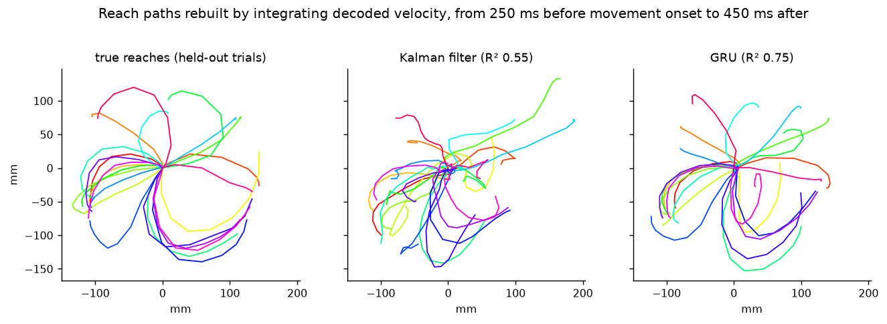
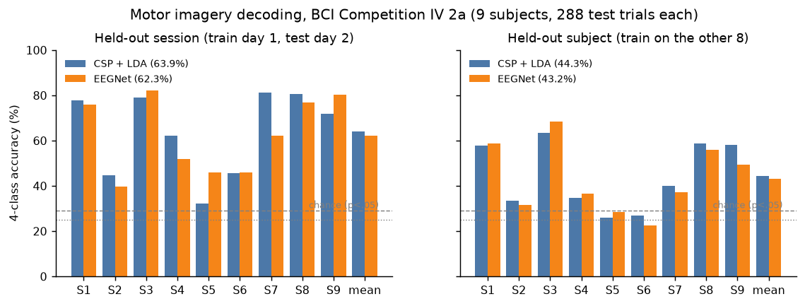
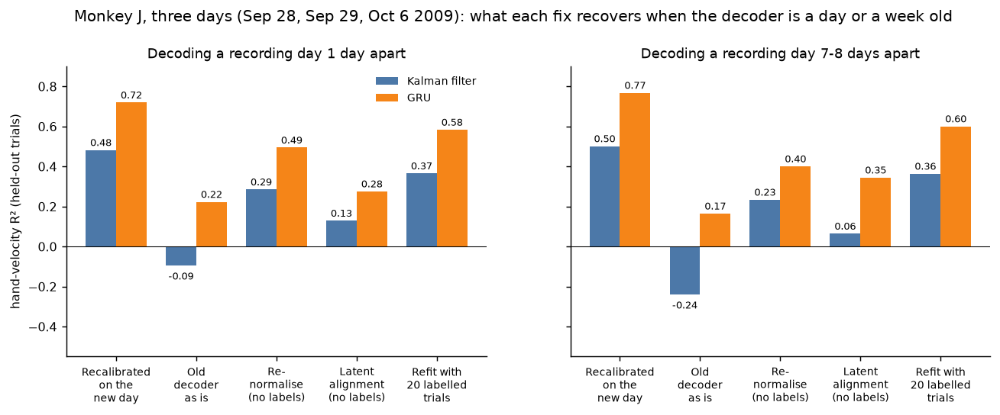
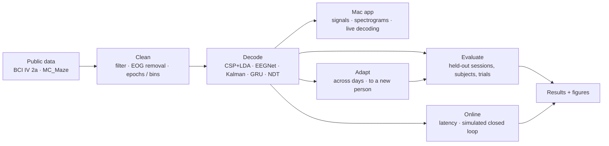

# Neural Signal ML

Decoding imagined movements from EEG and hand velocity from motor-cortex spikes: classic baselines vs neural networks on public data, a Mac app to view recordings and run the decoders, and a write-up that explains every method.

| Task | Classic baseline | Neural network |
|---|---|---|
| EEG motor imagery, 4 classes, **held-out day** (BCI IV 2a) | CSP + LDA **63.9%** | EEGNet **62.3%** |
| EEG motor imagery, 4 classes, **held-out person** | CSP + LDA **44.3%** | EEGNet **43.2%** |
| Hand velocity R², **held-out trials** (NLB MC_Maze, blocked CV) | Kalman filter **0.56** | GRU **0.80** |

**Making it work for a person**

| Problem | Without a fix | With one |
|---|---|---|
| Spike decoder, **one day to a week later** (mean R²) | GRU used as is: 0.19 | re-normalised, no labels: **0.43**; plus 10 labelled trials: **0.49** |
| EEG for a **new person, zero calibration** | CSP + LDA: 44.3% | aligned EEGNet: **50.5%** (better for 8/9 people) |
| **Closed loop** (simulated user steering a cursor) | Kalman: 39% of reaches | GRU: **61%** |
| **Real time** | textbook Kalman update: 28 ms per 50 ms bin | precomputed gains: **0.08 ms**, identical output |
| **Benchmark** (NLB co-smoothing, MC_Maze Medium, val split) | Smoothing: 0.097 bits/spike | Neural Data Transformer: **0.177** |

## Limits

- **Closed loop is simulated.** The closed-loop results use fitted model neurons and a simulated user. Real users adapt to the decoder, and no people or animals were tested live.
- **One monkey, three days** for the cross-day spike results.
- **Benchmark numbers are on the public val split.** They reproduce the published margin of NDT over the baseline, not the leaderboard's hidden-test scores. Larger published models score higher.

## Read more

- [Write-up: each method explained, and what worked](docs/WRITEUP.md)
- [Full results tables](results/Results.md)
- [Instructions: setup, training, the Mac app](docs/INSTRUCTIONS.md)
- [System design](docs/SYSTEM-DESIGN.md)
- [File structure](docs/FILE-STRUCTURE.md)

## License

MIT. See [LICENSE](LICENSE).
