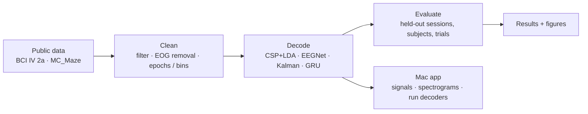

# Neural Signal ML

Decoding imagined movements from EEG and hand velocity from motor-cortex spikes: classic baselines vs neural networks on public data, a Mac app to view recordings and run the decoders, and a write-up that explains every method.

| Task | Classic baseline | Neural network |
|---|---|---|
| EEG motor imagery, 4 classes, **held-out day** (BCI IV 2a) | CSP + LDA **63.9%** | EEGNet **62.3%** |
| EEG motor imagery, 4 classes, **held-out person** | CSP + LDA **44.3%** | EEGNet **43.2%** |
| Hand velocity R², **held-out trials** (NLB MC_Maze, blocked CV) | Kalman filter **0.56** | GRU **0.80** |

## Read more

- [Write-up: each method explained, and what worked](docs/WRITEUP.md)
- [Full results tables](results/Results.md)
- [Instructions: setup, training, the Mac app](docs/INSTRUCTIONS.md)
- [System design](docs/SYSTEM-DESIGN.md)
- [File structure](docs/FILE-STRUCTURE.md)
