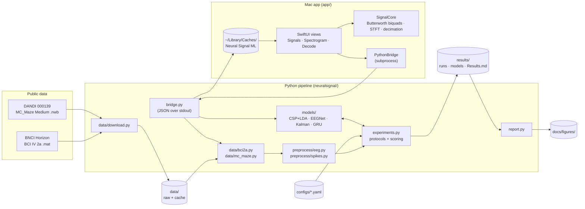

# System design

Neural Signal ML has two halves:

- **A Python pipeline.** It downloads public datasets, cleans them, trains decoders under explicit evaluation protocols, and writes metrics, models and figures.
- **A native Mac app.** It views recordings and runs the trained decoders. For reading file formats and running models it calls the same Python code, so there is only one implementation of every model.

## Architecture

## Components

| Component | Job |
|---|---|
| `data/download.py` | Fetches the 18 BCI 2a sessions from BNCI Horizon and the MC_Maze Medium train file from the DANDI API. Skips files it already has. |
| `data/bci2a.py` | Reads each session into runs (so filters never cross a recording gap), keeping the EOG calibration runs separate from the motor-imagery trials. |
| `data/mc_maze.py` | Reads the NWB file: spike times for 152 units, 1 kHz hand position and velocity, and the trial table with the NLB train/val split. |
| `preprocess/eeg.py` | EOG regression fitted on calibration runs, a causal Butterworth band-pass, epochs from cue +0.5 s to +2.5 s, optional resampling, and flags for bad trials. |
| `preprocess/spikes.py` | Counts spikes in bins with a 100 ms neural lead, cuts one fixed segment per trial around movement onset, and marks the window that gets scored. |
| `models/*` | The four decoders. Each docstring explains the method. `torch_fit.py` gives the neural nets the same `fit`/`predict` interface as the baselines. |
| `experiments.py` | Runs a config: for each protocol and fold it trains, scores and saves the model plus its metadata (including what it was trained on). |
| `evaluation/metrics.py` | Accuracy, Cohen's kappa, the binomial chance threshold, variance-weighted R², a trial-level bootstrap, and the Wilcoxon signed-rank test. |
| `report.py` | Builds `results/Results.md` and every figure from saved results. It never retrains. |
| `spikesort/demo.py` | A self-contained spike-sorting walkthrough on synthetic data with known ground truth. |
| `bridge.py` | The app's backend: `recordings`, `export`, `models` and `decode`, each answering with one JSON object. |
| `app/Sources/SignalCore` | Filters (RBJ biquads arranged as a 4th-order Butterworth, plus a notch) run with vDSP, an STFT spectrogram, and min/max decimation for drawing. Unit tested. |
| `app/Sources/NeuralSignalML` | SwiftUI app state (`AppModel`), the Python subprocess bridge, the views, Settings (⌘,) and Feedback. |

## Main flows

**Train.** `neuralsignal train CONFIG`
1. Load the config, hash it, and save the resolved copy and the environment.
2. Preprocess each session. EEG epochs are cached in `data/cache/`, keyed by a hash of the preprocessing settings.
3. For each protocol and fold:
   - Build the training set. Bad trials are dropped from training only.
   - Fit the model, then predict the untouched test set.
   - Score it and save the model with its metadata.
4. Write `metrics.json` and `predictions.npz`.

**Report.** `neuralsignal report` reads every `results/runs/*/metrics.json` and `predictions.npz`, then writes the tables and figures.

**View a recording in the app.**
1. On launch, the app asks the bridge for `recordings` and `models`.
2. When you pick a recording, `export` writes `meta.json` and raw `float32` arrays to the cache (reused until the source file changes), and the app memory-loads them.
3. Filtering and spectrograms run natively on a background task, so changing the band is instant and needs no Python.

**Decode in the app.** `decode --path FILE --model DIR`
1. The bridge loads the model and re-preprocesses the recording with *the model's own saved preprocessing settings*.
2. It predicts, then returns per-trial results plus an honesty flag: whether this recording, or these trials, were in the model's training data.

## Where data lives

| What | Where | In git? |
|---|---|---|
| Raw datasets | `data/bci2a/`, `data/mc_maze_medium/` | no |
| Preprocessed EEG epochs | `data/cache/*.npz` | no |
| Configs | `configs/*.yaml` | yes |
| Metrics, resolved configs, environment | `results/runs/<id>/` | yes (predictions excluded) |
| Trained models | `results/models/<id>/<protocol>/<target>/` | no (regenerate with `train`) |
| Summary tables, figures | `results/Results.md`, `docs/figures/` | yes |
| App export cache | `~/Library/Caches/Neural Signal ML/<recording>/` | n/a |
| App preferences | `UserDefaults` (`com.amalmehta.neuralsignalml`) | n/a |
| Feedback notes | `~/Library/Application Support/Neural Signal ML/feedback.jsonl` | n/a |

## Key decisions and trade-offs

| Decision | Why | Cost |
|---|---|---|
| Write CSP, Kalman, filtering and EOG regression by hand (numpy/scipy) instead of using MNE/MOABB/pyRiemann | This is a learning project: every step is readable in one file, and there are fewer dependency conflicts on an Intel Mac. | Less battle-tested than the libraries. Covered by synthetic tests where the answer is known. |
| Causal filters in the pipeline | An online BCI can't see the future. Zero-phase filtering would quietly use samples after the epoch. | Phase delay, which doesn't matter for band-power features. The app offers zero-phase as a display-only option. |
| Drop bad trials from training only | Rejecting noisy *test* trials would inflate accuracy. | A noisy test trial counts against the decoder, as it would in real use. |
| Held-out *session* and held-out *subject* protocols for EEG | Within-session cross-validation overstates BCI performance because of day-to-day drift. | Lower numbers than many papers report. |
| Held-out *trials* for spikes (NLB split + blocked CV) | MC_Maze Medium is one session from one monkey, so cross-session evaluation isn't possible with this file. | Doesn't measure drift across days. Listed as a limitation. |
| Blocked (contiguous) CV folds | Neighbouring trials are correlated, and random folds would leak. | Folds are slightly unbalanced in reach direction. |
| Same segments, bins and lag for Kalman and GRU; same epochs for CSP+LDA and EEGNet (except band and sample rate) | So each comparison measures the model, not the preprocessing. | Neither model gets its individually tuned best preprocessing. |
| Kalman state = position + velocity + acceleration, 50 ms bins | The classic formulation (Wu et al. 2003; Gilja et al. 2012). | Chosen after seeing that a velocity-only, 20 ms version did poorly on the val trials. Disclosed in the write-up; blocked CV is the cleaner estimate. |
| Mac app calls Python as a subprocess rather than re-implementing models in Swift / Core ML | One implementation of each model, so the app's predictions are exactly the pipeline's. | Needs the project's `.venv`. Each decode has a few seconds of Python start-up. |
| Native DSP in the app | Changing filters and spectrograms is interactive and needs no round trip. | The app's filter design (RBJ biquads) differs slightly from scipy's `butter`; the shape is the same (both 4th-order Butterworth). |
| Swift package + `build-app.sh` instead of an `.xcodeproj` | Plain-text, reviewable build that runs from the command line. | No Xcode asset catalogue. The icon is built by `make_icon.py`. |
| CPU-only training, `threads` per config, capped epochs for EEGNet held-out-subject folds | Intel Mac with no CUDA, and the machine was heavily loaded during the build. | The held-out-subject EEGNet may be slightly under-trained. Disclosed in the config and write-up. |

## Testing

- **`tests/test_methods.py`** (synthetic, runs anywhere):
  - the band-pass response
  - CSP+LDA recovering planted class-specific variance
  - the Kalman filter recovering linear tuning (this test caught a real bug, an information-form update that broke on zero-variance states)
  - the chance-level maths
  - EEGNet/GRU shapes and save/load round trips
  - spike sorting against ground truth
- **`tests/test_data.py`** (real data, skipped if not downloaded):
  - 2a session structure and epoch shapes
  - EOG regression lowering EEG-EOG correlation
  - MC_Maze segment shapes
  - bridge `recordings`/`export` output and JSON errors
- **`app/Tests/SignalCoreTests`**:
  - the Butterworth magnitude response
  - in-band/out-of-band filtering
  - zero-phase alignment
  - the notch
  - the spectrogram peak frequency
  - min/max decimation keeping extremes
- **End to end:** the bridge's `decode` on A01E with the A01 held-out-session CSP+LDA model reproduces the training run's 77.8%.

## Known limits

- **Offline only.** Everything is offline decoding of recorded data; closed-loop performance (the user adapting to the decoder) isn't measured.
- **Spike decoding** is tested on held-out trials of one session from one monkey. Nothing here measures performance across days.
- **Spike sorting** is shown only on synthetic data (MC_Maze arrives sorted). BIC model selection over-splits on some seeds.
- **EOG regression** removes some frontal brain signal along with eye artefacts. ICA would be the next step.
- **Statistics:** with 9 subjects, the Wilcoxon test can't reach p < 0.004, so "no significant difference" is weak evidence of equality.
- **App:** it reads only BCI-2a-style `.mat` and NLB `.nwb` files. EEG decoding works only on 2a sessions (the models expect those 22 channels). It needs the project's Python environment. It isn't notarised, so on first open macOS asks for Desktop/Documents access.
- **Results** were produced on a heavily loaded CPU. Wall-clock times in `results/` reflect that.
