# Neural Signal ML: what each method does, and what worked

Two decoding problems, each with a classic baseline and a neural network, evaluated on data the model never saw.

1. **Motor imagery from EEG** (BCI Competition IV 2a). Nine people imagined moving their left hand, right hand, feet or tongue, 288 times per session, on two different days. The task is to decode which of the four they imagined from 22 scalp electrodes.
2. **Hand velocity from motor-cortex spikes** (Neural Latents Benchmark MC_Maze Medium). A monkey made 250 reaches around a maze while 152 neurons in motor and premotor cortex were recorded. The task is to decode 2D hand velocity from the spikes.

Sections 1–3 cover those two problems and a spike-sorting demo. Sections 4–7 then take on what stands between these offline numbers and a BCI that works for a person:

4. **Across days.** Decoders degrade overnight. How much, and what fixes it?
5. **Real-time and closed loop.** Can each decoder keep up live, and how do they behave when the user steers by their output?
6. **A new user.** Can EEG work for someone with little or none of their own calibration data?
7. **The benchmark.** A Neural Data Transformer under the official Neural Latents Benchmark protocol.

All numbers come from `results/Results.md`, which is generated from the saved runs.

---

## 1. Motor imagery EEG

### The signal

Imagining a hand movement makes the 8–13 Hz **mu rhythm** over the *opposite* motor cortex shrink. This is event-related desynchronisation (ERD), and it's the signal every decoder here is really reading:

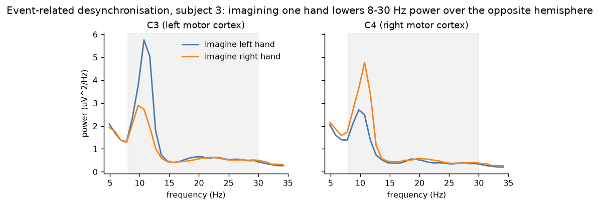

For subject 3, mu power over C3 (left motor cortex) is lower when imagining the *right* hand, and over C4 (right motor cortex) it's lower for the *left* hand.

### Cleaning

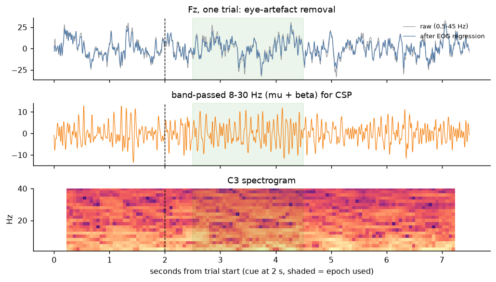

- **Eye artefacts.** Blinks and eye movements leak into frontal electrodes. Each 2a session starts with runs where the subject deliberately moves their eyes. We fit a least-squares map from the 3 EOG channels to each EEG channel on those runs, then subtract the predicted eye contribution everywhere (top panel: grey raw vs blue cleaned at Fz).
- **Band-pass.** A 4th-order Butterworth filter: 8–30 Hz (mu + beta) for CSP, and a wider 4–40 Hz for EEGNet so it can learn which frequencies matter. The filter is *causal*, as an online BCI must be.
- **Epoching.** We take 0.5–2.5 s after the cue (shaded), skipping the first 0.5 s where the visual response to the cue dominates.
- **Bad trials.** Trials with expert artefact marks or a peak-to-peak above 100 µV are dropped from *training only*. Test trials are never dropped, because dropping hard test trials would flatter the result.

### Method 1: CSP + LDA

**Common Spatial Patterns** learns weightings of the 22 electrodes (spatial filters) whose output variance differs as much as possible between one class and the rest. Mathematically, these are the extreme eigenvectors of the generalised eigenproblem C_class w = λ (C_class + C_rest) w. The log-variance of each filtered signal is a band-power feature. **Linear Discriminant Analysis** (with shrinkage, since 24 features from about 270 trials is a lot) then separates the four classes.

The *patterns* (not the filters) show where on the scalp each class's power change sits:

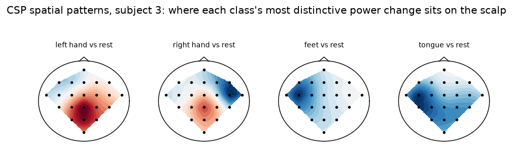

Left- and right-hand patterns sit over the motor strip, roughly opposite each other. Feet and tongue are less localised, which matches the confusion matrix below, where they're the classes most often mixed up.

### Method 2: EEGNet

EEGNet is a small CNN (about 3k parameters) whose first two layers mirror CSP:
- a temporal convolution that learns band-pass filters
- a depthwise convolution across all electrodes that learns spatial filters for each band

These are followed by pooling (a power envelope), a separable convolution and a linear classifier. It's trained with Adam for a fixed 300 epochs, keeping the weights with the lowest loss on a 20% validation split of the *training* session.

### Evaluation: held-out session and held-out subject

- **Held-out session:** train on a person's day 1 and test on their day 2. EEG drifts between days (electrode placement, impedance, fatigue), so this is harder than cross-validation within one day, which many papers report.
- **Held-out subject:** train on the other 8 people and test on someone the model has never seen. This is the "no calibration" scenario.

Chance is 25%. With 288 test trials, a random classifier exceeds 29.2% (84 of 288) only 5% of the time, so that is the real bar.

| | Held-out session | Held-out subject |
|---|---|---|
| CSP + LDA | **63.9% ± 17.6** (κ 0.52) | **44.3% ± 14.2** (κ 0.26) |
| EEGNet | **62.3% ± 15.9** (κ 0.50) | **43.2% ± 14.7** (κ 0.24) |

There is no significant difference between EEGNet and CSP + LDA. EEGNet beats the baseline on 4 of 9 subjects in each protocol, and the mean differences (−1.6 points held-out session, −1.1 points held-out subject) are well inside the noise (Wilcoxon signed-rank p = 0.65 and 0.50). The per-subject numbers move together (correlation 0.85 held-out session, 0.96 held-out subject): whoever is easy for one method is mostly easy for the other, though subjects 5 and 7 swing by 14–19 points between methods.

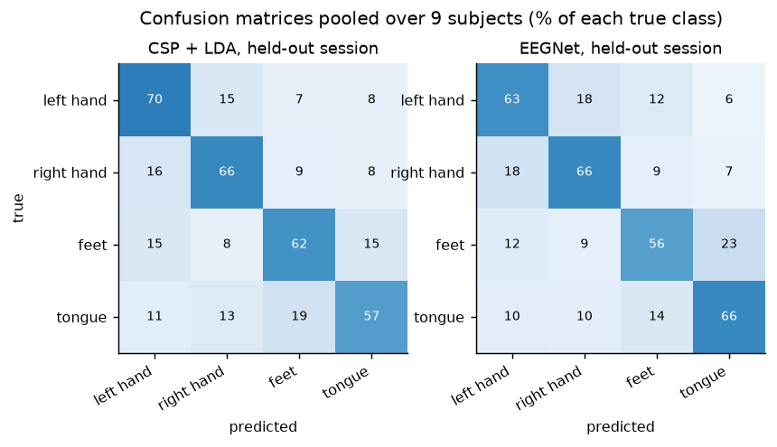

**What we learned**
- **Subjects matter more than methods.** Subjects 1, 3, 7, 8 and 9 are decoded at 70–80% by either method. Subjects 2, 5 and 6 sit near 30–45%, a well-known pattern: some people don't produce a clear ERD (so-called "BCI inefficiency").
- **Cross-subject transfer is hard.** Dropping the day-1 calibration data and using other people costs CSP + LDA about 20 points. Spatial patterns differ between heads.
- **A CNN doesn't beat a good spatial filter here.** With 288 trials per person, CSP + LDA already captures the main signal (power changes in the mu and beta bands over motor cortex). EEGNet's first layers are built to learn the same kind of spatial and frequency filters, and with this little data it has nothing extra to exploit, so it ties rather than wins. The neural network pays off in the spike data below, where there are many more channels and a time series to model.
- **A training-loop lesson.** The first EEGNet run used early stopping with patience 60. On subject 2, validation loss sat at ln 4 ≈ 1.386 (chance) for the first ~60 epochs, so training stopped and kept near-random weights, giving 24% test accuracy. Switching to the EEGNet paper's recipe (a fixed budget with a best-validation checkpoint) fixed it. The validation curve alone was enough to diagnose this.

---

## 2. Hand velocity from motor-cortex spikes

### Preprocessing

- **Binning.** Spikes are counted in 50 ms bins.
- **Neural lag.** Each velocity sample is predicted from spikes 100 ms *earlier*, because motor cortex leads movement.
- **Segments.** For every trial we cut a segment from 750 ms before movement onset to 450 ms after. The first 500 ms warm up the decoder's state, and R² is scored on −250 to +450 ms, the NLB window.

Both decoders get identical inputs.

### Method 1: Kalman filter

The Kalman filter models two linear-Gaussian relationships, both fitted by least squares:

- **The hand's dynamics:** x_t = A x_{t−1} + noise
- **How neurons encode the hand:** z_t = H x_t + noise

Here x is the hand's position, velocity and acceleration, and z is the vector of spike counts. Decoding alternates *predict*, where the dynamics carry the estimate forward, and *update*, where the new spikes correct it, weighted by the Kalman gain.

### Method 2: GRU

A gated recurrent network (128 hidden units) reads the square-rooted, z-scored counts bin by bin, causally, and outputs velocity. Unlike the Kalman filter, it can learn a nonlinear state, for example "the reach has started, and it's a curved one". It has far more parameters, so it uses dropout, weight decay and a best-validation checkpoint.

### Evaluation

MC_Maze Medium is a single session from one monkey, so we hold out *trials*:
- **NLB split:** the benchmark's own split, 188 training and 62 test trials.
- **Blocked CV:** 5 folds of *contiguous* trials, so a test trial's correlated neighbours can't be in training.

R² is the variance-weighted coefficient of determination over x and y velocity.

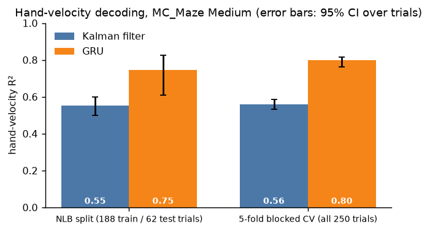

| | NLB split | 5-fold blocked CV |
|---|---|---|
| Kalman filter | **0.554** (CI 0.50–0.60) | **0.559** (CI 0.53–0.59) |
| GRU (3 seeds) | **0.746** (CI 0.61–0.83) | **0.800** (CI 0.76–0.81) |

Pairing the two models on the same test trials, the GRU is better by **+0.18 R²** on the NLB split (95% CI +0.05 to +0.28) and by **+0.23** under blocked CV (95% CI +0.20 to +0.26).

Integrating the decoded velocity reconstructs the reach paths (held-out trials):

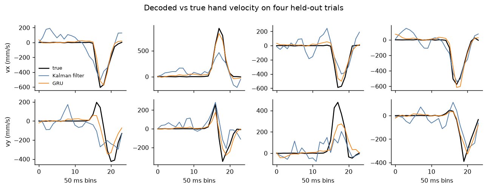

**What we learned**
- **The GRU wins clearly.** Its traces follow the bell-shaped speed profile and its reconstructed paths fan out in the right directions. The Kalman filter's paths are right on average but noisier and often too short.
- **How you set up the baseline matters as much as the model.** Our first Kalman filter, with a velocity-only state and 20 ms bins, scored R² 0.28. With 50 ms bins it reached 0.38, and adding position and acceleration to the state (the original Wu et al. 2003 formulation) gave 0.55. *Caveat:* I made these choices after seeing the NLB val-trial score of the first version. They follow the published formulations rather than a search, and the blocked-CV score (0.559) agrees, but the NLB-split Kalman number isn't fully untouched.
- **A real bug caught by a synthetic test.** The first Kalman update used the "information form", which inverts the state covariance. That breaks for states with zero variance, such as the constant term. A test on synthetic data with known tuning failed (R² −18), and the covariance-form update fixed it.

---

## 3. Spike sorting (synthetic demo)

MC_Maze arrives already sorted, so this demo shows the upstream step on a simulated 30 kHz recording with three neurons whose true spike times are known:

1. Filter 300–3000 Hz.
2. Detect crossings of −4.5× a robust noise estimate (median absolute value / 0.6745).
3. Cut aligned 1.6 ms waveforms.
4. Reduce them with PCA.
5. Cluster with a Gaussian mixture, with the number of units picked by BIC.

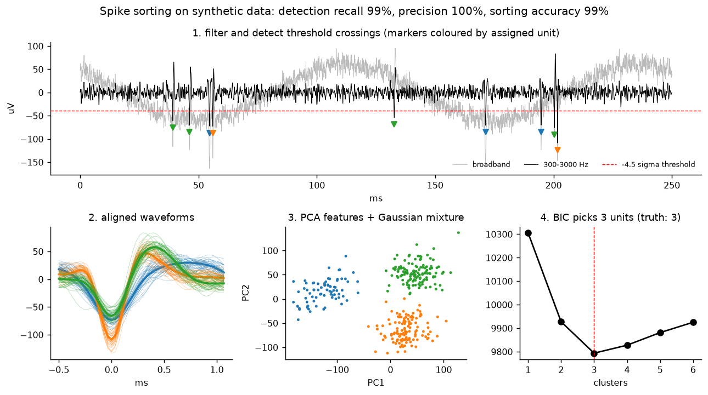

- **Results:** recall 98.8%, precision 100%, sorting accuracy 98.8%. On four more simulated recordings, sorting accuracy stays at 97–99%.
- **Over-splitting:** BIC over-splits on those recordings, finding 4–6 clusters for 3 neurons. In real sorters a merge step (or a person) fixes that.
- **Similar neurons merge:** in an earlier version, two neurons with similar filtered waveforms merged into one cluster, the opposite failure.

---

## 4. Decoders that survive across days

### The problem

An implanted array records a slightly different set of neurons every day: electrodes shift by micrometres, cells go quiet, and new ones appear. A decoder fitted on Monday is miscalibrated by Tuesday. Clinical systems handle this by recalibrating at the start of every session, which costs the user minutes of their time every day. How much does drift cost, and how much can be recovered without asking the user for anything?

### Setup

MC_Maze comes in three sizes, which are actually **three recording days from the same monkey on the same two Utah arrays**: Sep 28 (Small, 100 trials), Sep 29 (Medium, 250) and Oct 6 2009 (Large, 500). Pairing them gives gaps of 1 day and 7–8 days.

**A shared input space.** Sorted units are different on each day, so every decoder reads spike counts summed per **electrode**. To check that electrodes really correspond across days, I fitted each electrode's preferred reach direction on each day. On well-tuned electrodes it moves only 20–32° between days, against 90° expected if the mapping were scrambled. Mean firing rates correlate only about 0.3 across days, though, so the drift is real.

**Methods,** for every ordered pair of days (6 pairs). Each decoder reads the channels that fired on its training day. All methods are tested on the new day's NLB val trials, which no method ever sees.
- **Recalibrated:** trained on the new day's own training trials. This is the reference.
- **Old decoder as is:** what happens if you just keep going.
- **Re-normalise (no labels):** replace each channel's mean and standard deviation with the new day's. It needs only the new day's spikes, not any movement data.
- **Latent alignment (no labels; Degenhart et al. 2020):**
  1. Fit factor analysis on each day.
  2. Rotate the new day's factors onto the old day's, using the channels whose loadings agree best.
  3. Keep the decoder that was trained on the old day's factors.
- **Few-shot recalibration:** k labelled trials from the new day.
  - Kalman: refit only the observation model (how neurons encode movement), keeping the movement dynamics.
  - GRU: refit only the input layer, keeping the recurrent dynamics and readout.
  - Both are compared with training from scratch on the same k trials.

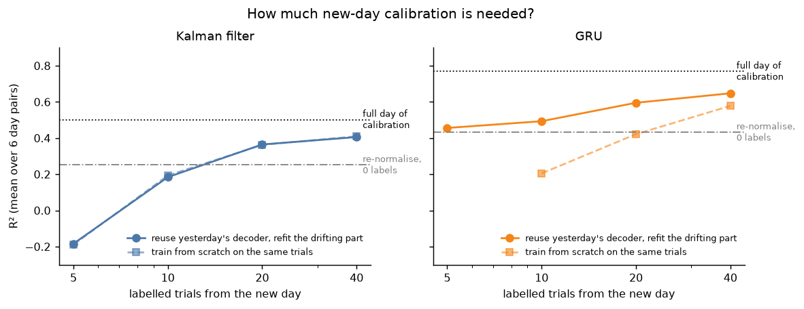

| Mean over 6 day pairs (R²) | Kalman | GRU |
|---|---|---|
| Recalibrated on the new day | 0.50 | 0.77 |
| Old decoder as is | **−0.19** | 0.19 |
| Re-normalise (0 labels) | 0.25 | **0.43** |
| Latent alignment (0 labels) | 0.09 | 0.32 |
| Refit with 10 labelled trials / from scratch | 0.18 / 0.19 | **0.49 / 0.21** |
| Refit with 40 labelled trials / from scratch | 0.41 / 0.41 | **0.65 / 0.58** |

**What we learned**
- **Drift is severe.** An unadapted Kalman filter is worse than predicting zero velocity (negative R²), even one day later. The GRU degrades less but still loses three-quarters of its performance.
- **The cheapest fix is the best zero-label fix.** Re-normalising each channel with the new day's statistics needs no labels and no user effort. It recovers 64% of the lost R² for the Kalman filter and 41% for the GRU, more than latent alignment does here.
- **Why latent alignment underperforms here.** Two measurable reasons:
  - Compressing about 70 electrodes into 12 factors already costs a lot. A same-day latent Kalman reaches only 0.33, against 0.50 on raw channels.
  - Alignment assumes most channels are stable. Here the neurons change on most electrodes, which matches the low rate correlation.

  The method was designed for chronic arrays recorded continuously over weeks; this data has gaps and only about 70 active electrodes.
- **Reusing the old network beats starting over, for the GRU.** With 10 labelled trials (under half a minute of reaching), refitting only the GRU's input layer gives 0.49, against 0.21 from scratch. The network's learned movement dynamics carry over between days; only the mapping from electrodes changes. The Kalman filter gets no such benefit: its movement model is only a few numbers and is re-learned easily from a few trials, so refitting H and Q ≈ refitting everything.

## 5. Real-time decoding and closed-loop use

### Online latency

A real BCI decodes each bin of spikes as it arrives (every 50 ms here) and must finish before the next one. Both spike decoders are causal, so running them bin by bin gives *exactly* their offline predictions; a test checks this. What changes is that each update must be fast.

| Decoder | Median per update | 95th percentile | Budget |
|---|---|---|---|
| Kalman filter | 0.08 ms | 0.25 ms | 50 ms |
| GRU | 1.6 ms | 17 ms | 50 ms |
| CSP + LDA (sliding 2 s window every 250 ms) | 3.0 ms | 17 ms | 250 ms |
| EEGNet (same) | 6.1 ms | 30 ms | 250 ms |

These were measured single-threaded on a heavily loaded Intel laptop (load average about 75). Two engineering lessons came out of getting there:
- **Precompute the Kalman gain.** The textbook update solves a 152×152 linear system every bin, which took a median 28 ms and 146 ms at the 95th percentile here, too slow. But the Kalman gain depends only on the model, never on the spikes, so the whole sequence of gains can be computed before decoding starts. Each update then becomes a few matrix-vector products: 0.08 ms, with identical output. This is standard in clinical systems.
- **One thread for one update.** PyTorch's default of one thread per core cost the GRU 47 ms per update, because coordinating threads is slower than the work itself. Pinning it to one thread brings it to 1.6 ms.

The Mac app's **Live** tab runs any decoder this way and plays the output back in real time (a cursor driven by decoded spikes, or motor-imagery probabilities updating every 250 ms), with these latencies measured live.

### Simulated closed loop

Offline, a decoder predicts movements the arm actually made. In a real BCI there is no arm. The user watches the cursor the decoder produces and corrects it, so decoder errors feed back into the neural activity. It's well known that offline accuracy predicts this closed-loop performance poorly (Koyama et al. 2010). To probe it without a participant, I built a closed-loop simulator in the spirit of Cunningham et al. (2011):

- **Neurons:** each MC_Maze unit's tuning to intended velocity, fitted on real data with a Poisson GLM.
- **User:** sees the cursor 100 ms late (visual delay), steers toward the target with a proportional controller capped at the monkey's real peak speed, and adds motor noise.
- **Task:** 8 targets 100 mm away; success means holding inside a 15 mm target for 250 ms within 3 s.
- **Decoders:** trained the normal way on simulated open-loop data, then put in the loop.

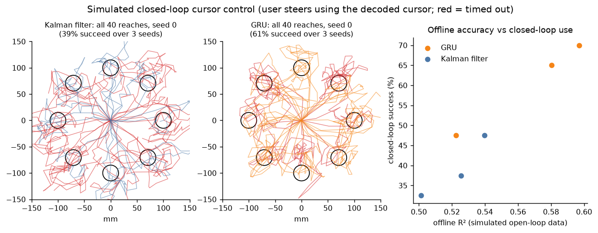

| | Offline R² | Closed-loop success | Median time to target |
|---|---|---|---|
| Kalman filter | 0.52 | **39%** | 1.6 s |
| GRU | 0.57 | **61%** | 1.9 s |

A 0.05 difference in offline R² becomes a **22-point** difference in closed-loop success. Small offline errors compound when the user has to correct for them in real time. The ranking agrees with offline R², but its size doesn't, which is why the field judges BCIs on closed-loop task performance.

**Caveat:** this is a simulated user with simple GLM neurons. Real neurons have richer dynamics, and real users learn the decoder, which often helps simpler decoders more. The simulator ranks decoders under a stated model. It is not a substitute for a user study.

## 6. EEG that works without calibration

### The problem

In section 1, decoding someone the model had never seen (held-out subject) dropped CSP + LDA from 64% to 44%. That gap is what stops EEG BCIs working "out of the box": today a new user must first record a labelled calibration session, typically 20–30 minutes of imagining on cue. Can we close the gap with no labels, or very few?

### Why people differ, and the fix

Every head is different (skull thickness, electrode fit, baseline rhythms), so each person's EEG covariance matrices sit in a different region of the space of covariance matrices. A decoder trained on other people sees a new person's data as *shifted*. **Alignment** removes the shift without labels: estimate where this person's data is centred (their mean covariance, from any *unlabelled* EEG), and move it to a common reference point.

- **Euclidean alignment** (He & Wu 2019): whiten each person's trials with the inverse square root of their average covariance. Afterwards, everyone's mean covariance is the identity.
- **Riemannian re-centring** (Zanini et al. 2018): the same idea using the *Riemannian* mean, the right notion of "average" for covariance matrices, because their space is curved. Classification then uses tangent vectors (the matrix logarithm at the re-centred origin) and LDA.

Protocol: each person's day-2 session is the test set. Their day-1 EEG is "the first minutes of using the BCI": it is used *unlabelled* for alignment, and in the calibration curve k labelled trials per class are drawn from it. Training uses the other 8 people, each session aligned to itself.

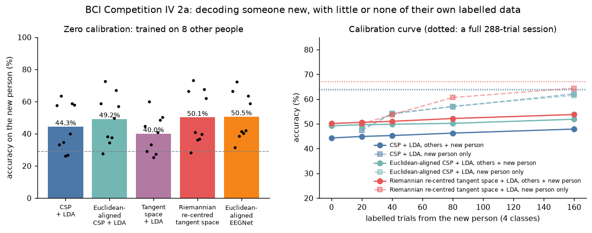

| Zero calibration (trained on 8 other people) | Accuracy | Better than CSP + LDA on |
|---|---|---|
| CSP + LDA | 44.3% | n/a |
| Tangent space + LDA, **no** re-centring | 40.0% | 2 of 9 people |
| Euclidean-aligned CSP + LDA | 49.2% | 7 of 9 (Wilcoxon p = 0.039) |
| Riemannian re-centred tangent space + LDA | 50.1% | 7 of 9 (p = 0.027) |
| Euclidean-aligned EEGNet | **50.5%** | 8 of 9 (p = 0.012) |

Then, adding labelled trials from the new person (Riemannian method):

| Labelled trials from the new person | 0 | 20 | 40 | 80 | 160 | Full session (~270) |
|---|---|---|---|---|---|---|
| Others + new person, pooled | 50.1% | 50.6% | 51.0% | 52.1% | 53.8% | n/a |
| New person only | n/a | 50.0% | 53.7% | 60.6% | **64.4%** | 67.0% |

**What we learned**
- **Alignment is the single biggest win for a new user, and it's free.** It needs only a few minutes of unlabelled EEG. Accuracy goes from 44% to 50%, consistently across people. EEGNet benefits most: 43.2% unaligned (section 1) against 50.5% aligned.
- **The control proves the mechanism.** The same tangent-space classifier *without* per-person re-centring does worse than CSP (40%). Removing each person's shift is what matters, not the classifier.
- **Pooling a little labelled data with everyone else's barely helps** (+3.7 points at 160 trials), because 160 trials are swamped by about 4,500 from other people. From about **40 labelled trials (10 per class, roughly 5 minutes of cued imagery) onward, the new person's own data alone wins.** With 160 trials (about 20 minutes) it reaches 64%, close to a full session.
- **A practical recipe follows:** start a new user on an aligned cross-subject decoder (about 50% from minute one), then switch to their own data once they have about 40 labelled trials. A method that *weights* the new person's trials more heavily than other people's would probably beat both curves; that's a natural next experiment.
- **Still far from solved.** Even aligned, three of nine people stay below 40%. Some people produce weak motor-imagery rhythms at any calibration level (see section 1).

## 7. Toward the state of the art: the Neural Latents Benchmark

### The task

The Neural Latents Benchmark (Pei et al. 2021) asks a different question from velocity decoding: **does a model capture the population's dynamics?** Each trial's neurons are split into *held-in* neurons, given to the model, and *held-out* neurons, hidden from it. The model must predict the held-out neurons' firing rates from the held-in neurons alone. The score is **co-smoothing bits per spike** (co-bps): how much better the predicted rates explain the held-out spikes than each neuron's mean rate, in bits per spike.

### Models

- **Smoothing** (the official baseline): Gaussian-smooth the held-in spikes, then fit a Poisson regression from them to each held-out neuron.
- **Neural Data Transformer** (Ye & Pandarinath 2021): a transformer encoder over 5 ms time bins, trained BERT-style. A quarter of the time bins are hidden from the input, and the model must reconstruct every neuron's spikes there. Because it can't just copy its input, it has to learn how the population evolves. Here it is small (2 layers, width 64, about 93k parameters) because it trains on about 190 trials on a CPU.

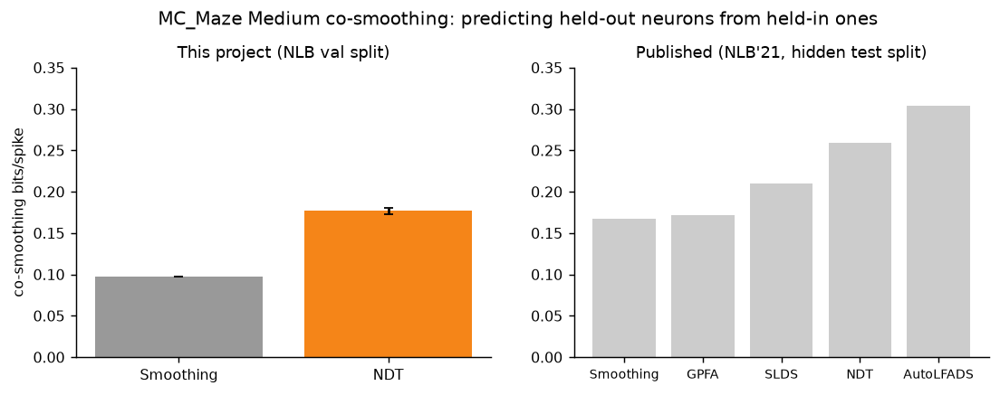

| MC_Maze Medium | co-bps, this project (NLB val split) | vel R² from rates | co-bps, published (hidden test split) |
|---|---|---|---|
| Smoothing | 0.097 | 0.30 | 0.167 |
| NDT | **0.177 ± 0.004** (3 seeds) | **0.44** | 0.259 |

**How to read this.** Published numbers are scored on NLB's hidden *test* split through EvalAI, while this project can only score the public *val* split. Both models score lower on val by a similar factor (Smoothing 0.58×, NDT 0.68× the published value), so the useful comparison is against the baseline on the same split:
- Here, the NDT improves on Smoothing by **+0.080 bits per spike (+82%)**.
- In the paper the improvement is +0.092 (+55%).

This reproduces the published *gap*, not the published absolute numbers. Submitting to EvalAI needs an account and is left to the project owner.

**What we learned**
- **Two bugs, both caught by checking against a baseline.** The first full NDT run scored about 0 co-bps, no better than predicting each neuron's average.
  - The held-out neurons were only scored at masked time bins, so the model never learned to predict them from ordinary, unmasked input. Held-out neurons are never in the input, so the fix is to score them at every bin.
  - The output layer started out predicting about 50× too many spikes per bin, and a CPU-sized training budget went on unlearning that. The fix is to start it at each neuron's mean rate.

  After fixing both, 100 epochs already beat Smoothing. Without the baseline as a sanity check, the broken run could have been reported as "transformers don't help on small data".
- **Velocity from inferred rates (0.44) is far below the supervised GRU (0.75, section 2).** These answer different questions. The benchmark's velocity score is a ridge regression at a single time bin from rates the model learned *without seeing velocity*. The GRU was trained directly on velocity. Latent dynamics models are about understanding the neural population, and a supervised decoder still wins at decoding.

## Honest caveats

- **Closed loop is simulated, not measured with people:** the simulator (section 5) uses GLM neurons and a model user. Real users adapt to the decoder, and real closed-loop performance can differ substantially.
- **Not state of the art:** section 7 runs a small NDT under the official benchmark protocol and reproduces its published margin over the Smoothing baseline. Absolute numbers are on the val split, not the leaderboard's hidden test split. Larger published models (AutoLFADS, STNDT, and newer pretrained ones) score higher.
- **Three days, one monkey:** the cross-day results (section 4) cover gaps of 1 and 7–8 days in one animal. Longer gaps, other people and other arrays may behave differently.
- **Small n for EEG statistics:** with 9 subjects, a Wilcoxon test can't go below p ≈ 0.004.
- **Compute caps:** the held-out-subject EEGNet folds were capped at 80 epochs and one seed, because training ran on a heavily loaded CPU.
- **Hand-written methods:** everything is implemented from scratch for clarity (no MNE, MOABB or pyRiemann). It's tested on synthetic data, but less battle-tested than those libraries.

## References

- Brunner et al. (2008), *BCI Competition 2008 – Graz data set A* (BCI IV 2a).
- Pei et al. (2021), *Neural Latents Benchmark '21*. Churchland et al. (2012), the maze task.
- Ramoser, Müller-Gerking & Pfurtscheller (2000), *Optimal spatial filtering of single trial EEG during imagined hand movement* (CSP).
- Lawhern et al. (2018), *EEGNet: a compact convolutional neural network for EEG-based brain–computer interfaces*.
- Wu et al. (2003), *Neural decoding of cursor motion using a Kalman filter*. Gilja et al. (2012), *A high-performance neural prosthesis enabled by control algorithm design*.
- Schlögl et al. (2007), *A fully automated correction method of EOG artifacts in EEG recordings*.
- Ye & Pandarinath (2021), *Representation learning for neural population activity with Neural Data Transformers*.
- He & Wu (2019), *Transfer learning for brain–computer interfaces: a Euclidean space data alignment approach*. Zanini et al. (2018), *Transfer learning: a Riemannian geometry framework with applications to brain–computer interfaces*. Barachant et al. (2012), *Multiclass brain–computer interface classification by Riemannian geometry*.
- Degenhart et al. (2020), *Stabilization of a brain–computer interface via the alignment of low-dimensional spaces of neural activity*.
- Cunningham et al. (2011), *A closed-loop human simulator for investigating the role of feedback control in brain-machine interfaces*. Koyama et al. (2010), *Comparison of brain–computer interface decoding algorithms in open-loop and closed-loop control*.
- Haufe et al. (2014), *On the interpretation of weight vectors of linear models in multivariate neuroimaging*.
- Quiroga, Nadasdy & Ben-Shaul (2004), *Unsupervised spike detection and sorting with wavelets and superparamagnetic clustering*.
